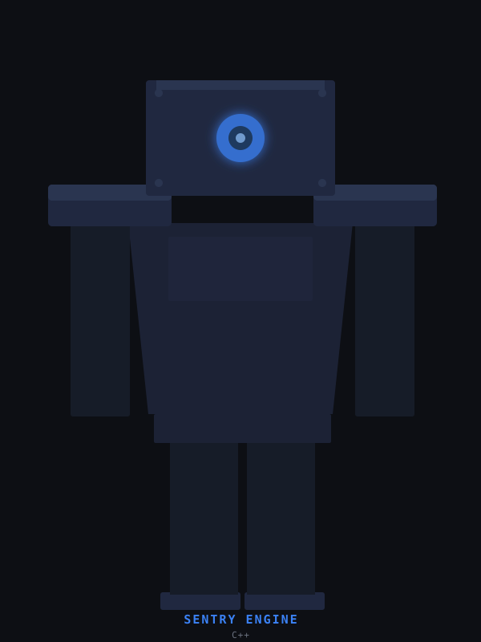
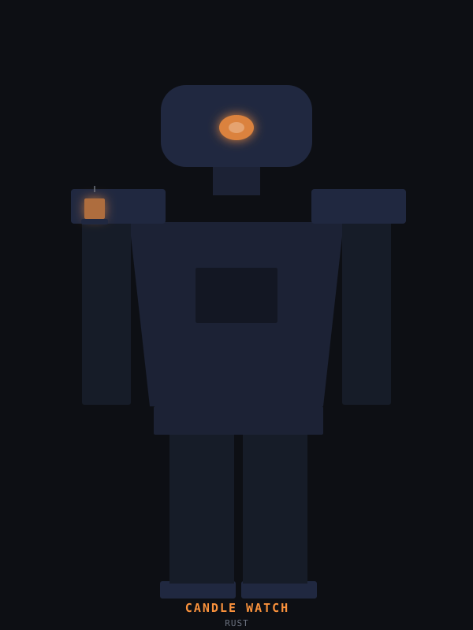
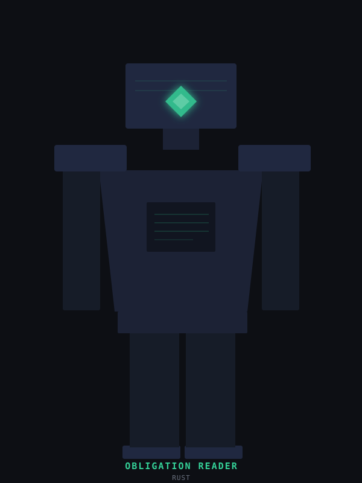
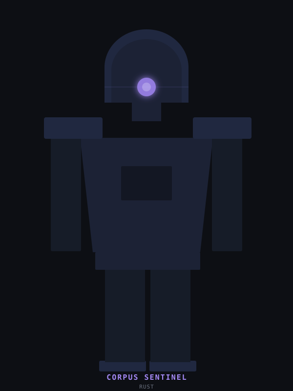
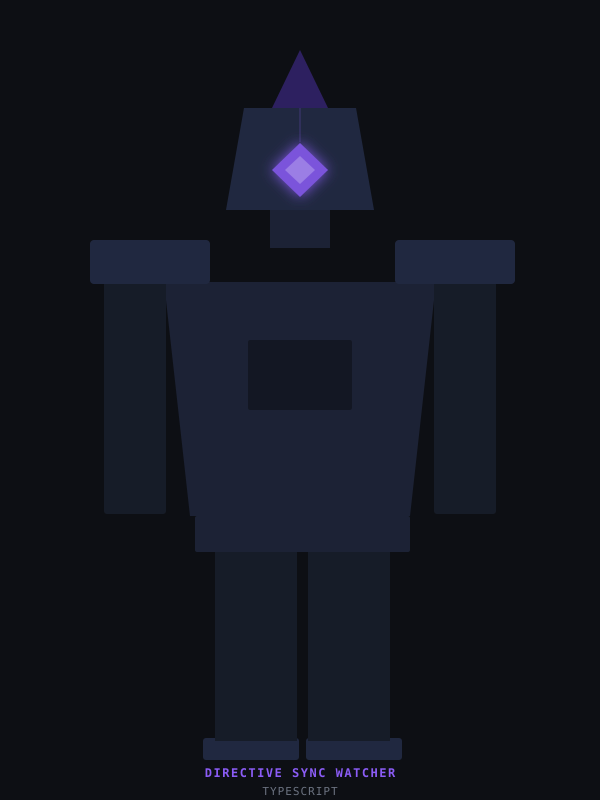
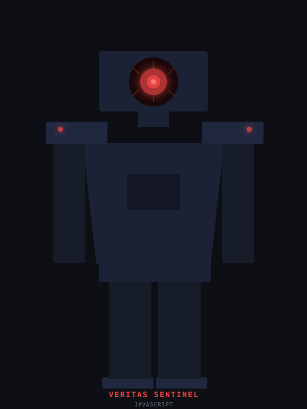
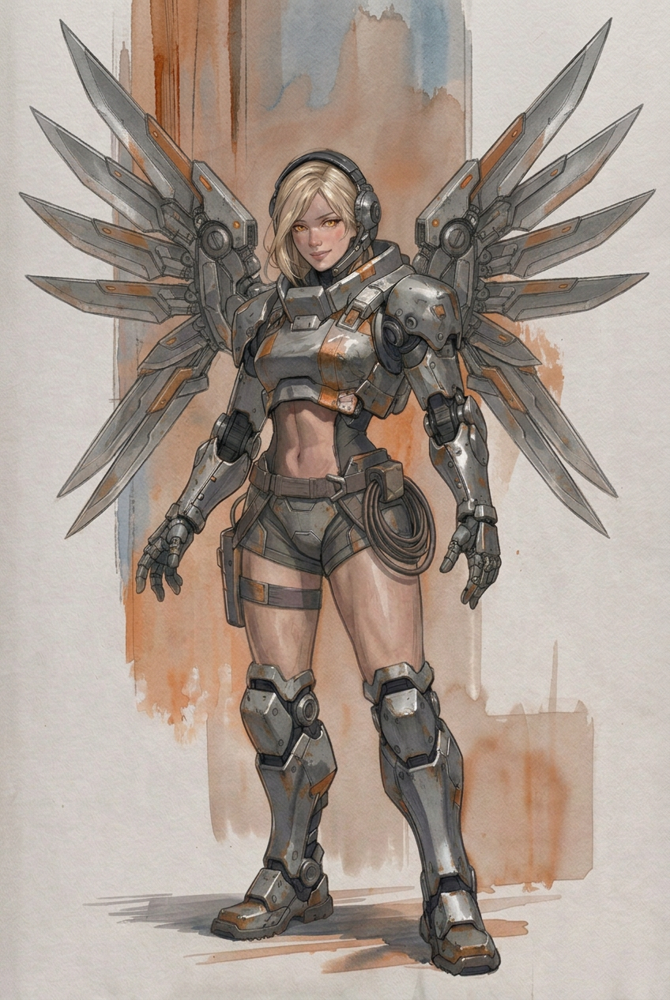
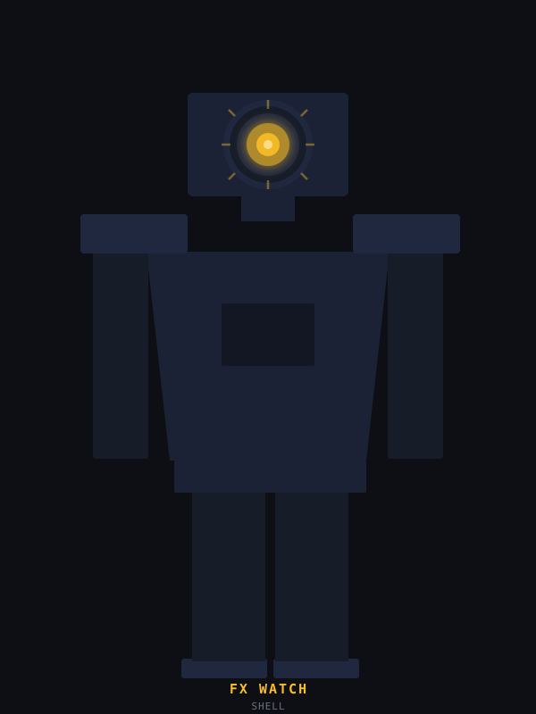

# Sentinels

Independent, read-only watchdogs over production systems, each written in the language that fits its host. Built by Flavio Espinoza, every one of them with a Claude Code agent at the keyboard.

**Docs site:** [flavioespinoza.github.io/sentinels](https://flavioespinoza.github.io/sentinels/)

## What A Sentinel Is

A sentinel is a guard posted outside a system to watch it and raise the alarm. It never acts. It reads what the system exposes, compares it against a line drawn in advance, and the moment the line is crossed it pages a person. Then it goes back to watching.

The rule is the same for every one of them:

- **`A`**: `It Cannot Act On The System It Watches` -- a sentinel reads a feed, a folder, a log, or a chain. It holds nothing that could place a trade, close a position, or change the thing it guards. If the sentinel itself is compromised, the worst it can do is page.
- **`B`**: `It Holds No Key` -- no signing key, no credential that moves money. A bearer token to read a feed is the most it carries, and that token is a secret in the host, never a line in a file.
- **`C`**: `It Pages A Person` -- a sentinel decides nothing. It raises an alert once, at the first crossing, sends it to a phone, and stays quiet until the condition clears. The chain of watchers ends at a desk, where a person makes the call.

It is turtles all the way down: a watcher over the engine, a watcher over the watcher, and at the bottom a human. The file watchers at the end of the roster bend the first rule on purpose: each one acts on the folder it watches, and on nothing else.

Each sentinel is meant to stand on its own, with its own build and its own tests and nothing shared between them, so a visitor can take the one in the language they want and leave the rest. Today the C# sentinel lives in this repo at the root. The others are listed with where their code lives now, and each one has a page under `_deep-dives/` that says what it is, how it works, what it is useful for, and how far along it honestly is.

## The Roster

### Sol Bot Sentinel

`C# + ASP.NET Core`

**Status:** deployed on production, on Cloud Run, since Oct 05 2026.

Every 15 seconds it reads the feed of two live auto-traders and pages a phone on a missed trend flip, a position past a risk line, or a bot out of bounds or gone quiet.

[Deep dive: Sol Bot Sentinel](_deep-dives/sol-bot-sentinel.md)

### Sentry Engine

`C++`

**Status:** running in tests; the graph scheduler is a stub; code in a private repo, to be rebuilt here from source.

The real-time audio engine under a home security sentry. Its sound filter is real and tested, and its graph scheduler is still a stub.

[Deep dive: Sentry Engine](_deep-dives/sentry-engine.md)

### Candle Watch

`Rust`

**Status:** specified; build in progress; code in a private repo, to be moved here.

Watches every market for candles that stop arriving, go flat, or cannot be read. It pages when a market goes wrong and once when it recovers, and never repairs or trades.

[Deep dive: Candle Watch](_deep-dives/candle-watch.md)

### Obligation Reader

`Rust`

**Status:** specified; build in progress; code in a private repo, to be moved here.

Reads a lending position straight from the chain and sets each reading beside the engine's own number. When the two disagree it pages a person, and it never feeds a decision.

[Deep dive: Obligation Reader](_deep-dives/obligation-reader.md)

### Corpus Sentinel

`Rust`

**Status:** designed; first pieces building; code in a private repo, to be moved here.

A small, hard front door for a retrieval engine that must stay loaded in memory. It turns away callers with no token or over the rate limit and passes the rest to the engine.

[Deep dive: Corpus Sentinel](_deep-dives/corpus-sentinel.md)

### Tribal Knowledge Watcher

`TypeScript`

**Status:** built; runs from its home repo, `watcher-tribal-knowledge`.

Watches a folder for Slack screenshots and turns each one into structured Markdown, transcribed word for word and filed under an index. Then it plays the drums and pops an alert.

[Deep dive: Tribal Knowledge Watcher](_deep-dives/tribal-knowledge-watcher.md)

### Directive Sync Watcher

`TypeScript`

**Status:** built; runs from its home repo, `watcher-directive-sync`.

Watches a folder of specs and keeps a rules file in sync with them. When a spec changes, it swaps the new text in between two markers, with no AI involved.

[Deep dive: Directive Sync Watcher](_deep-dives/directive-sync-watcher.md)

### Veritas Sentinel

`JavaScript`

**Status:** built; lives in its home repo, `veritas-sentinel`.

Watches the logs of AI agent sessions and writes every turn into a live Markdown page in the editor. When an assistant turn runs long with no tool call, it warns on the console.

[Deep dive: Veritas Sentinel](_deep-dives/veritas-sentinel.md)

### Mercy

`JavaScript`

**Status:** older code; lives in its home repo, eScanner.

The oldest sentinel, a Node watcher that copies an exchange's candles, order book, and trades for every market quoted in BTC, ETH, USDT, or USD into Elasticsearch. It predates the three rules above.

[Deep dive: Mercy](_deep-dives/mercy.md)

### FX Watch

`Shell`

**Status:** running as a macOS launch agent; code in its home repo, `fx-renamer`.

Watches the screenshot folder and gives each new capture one lowercase, sortable, timestamped name, five seconds after it lands. It never touches a file that was already there.

[Deep dive: FX Watch](_deep-dives/fx-watch.md)

